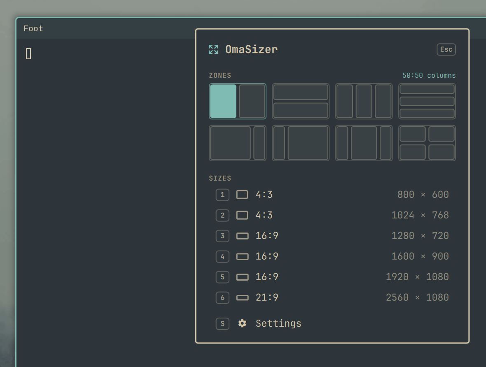
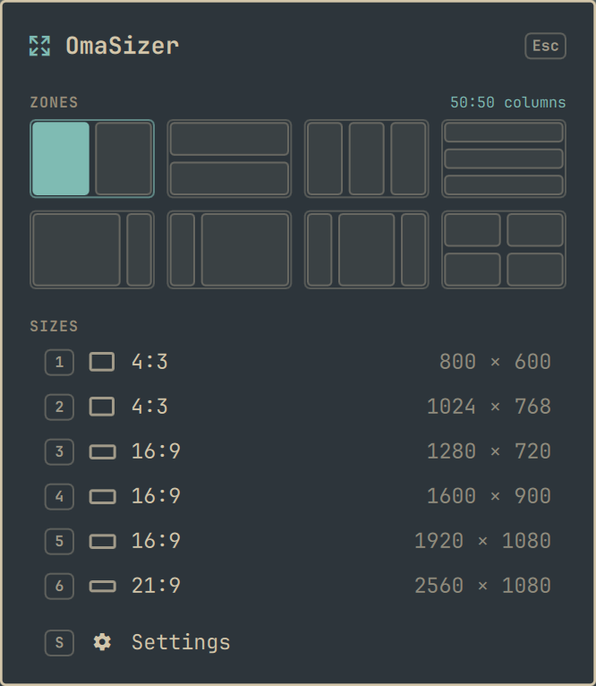
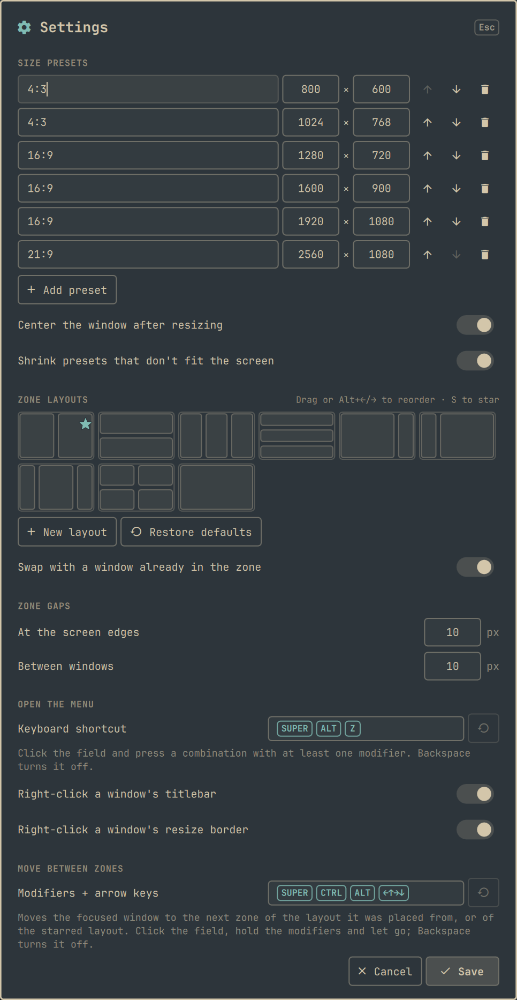
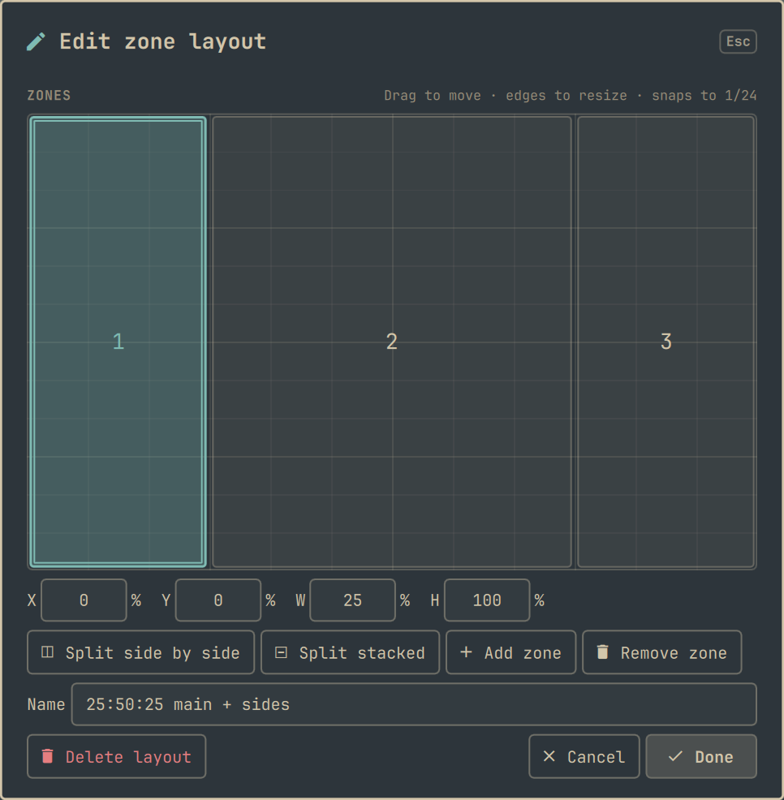

# OmaSizer

**An essential companion for [Omarchy](https://omarchy.org)'s floating layout.**

Omarchy 4.5's floating workspaces give every window a titlebar and the freedom to go anywhere, but no quick way to give a window an exact size or a tidy spot. OmaSizer fills that gap with what Windows and KDE users have long relied on: zones like PowerToys [FancyZones](https://learn.microsoft.com/en-us/windows/powertoys/fancyzones), and exact sizes like [Sizer](https://www.brianapps.net/sizer4/) and [KSizer](https://github.com/allenguarnes/KSizer). Right-click a window's titlebar, pick a zone or a size, and the window lands exactly there.

<p align="center">
  
</p>

## Features

- **Snap to zones.** Move a window into half, a third, a quadrant or any zone you draw. It fills the zone with the same gaps tiled windows get, titlebar included.
- **Resize to preset sizes.** Set exact sizes such as 1280 × 720 or 1920 × 1080, centered on the screen and shrunk to fit if they're too big.
- **Open it with the mouse.** Right-click a floating window's titlebar, any of its buttons, or its resize border, and the menu opens right at the cursor.
- **Or with the keyboard.** <kbd>Super</kbd> + <kbd>Alt</kbd> + <kbd>Z</kbd> opens it for the focused window. Number keys pick sizes, and arrows walk through the zones.
- **Visual zone editor.** Drag zones, resize them by their edges, split and name them. Everything snaps to a grid, so halves, thirds and quarters line up exactly.
- **Settings in the overlay.** Presets, layouts, gaps and behavior can all be changed with the mouse or entirely from the keyboard.
- **Feels native.** It follows your Omarchy theme and uses Omarchy's own UI components.

## Requirements

- Omarchy 4.5 or later.
- The right-click menu works on floating windows. The titlebar right-click needs Omarchy's floating workspace layout, which draws the titlebars.
- The keyboard shortcut works on any window. A tiled window is floated before it's resized or moved into a zone.
- Uses `bash`, `jq` and Hyprland's `hyprctl`, which come with Omarchy. Nothing else needs to be installed, and nothing runs with elevated privileges.

## Install

```bash
omarchy plugin add https://github.com/allenguarnes/omasizer.git --enable
```

That's all. OmaSizer registers its keyboard shortcut and right-click hook with Hyprland itself, at runtime, every time the shell starts and after every Hyprland config reload. It never edits your config files.

If <kbd>Super</kbd> + <kbd>Alt</kbd> + <kbd>Z</kbd> is already bound to something else, OmaSizer leaves your binding alone, tells you with a notification, and lets you pick another shortcut in its settings.

## Usage

<p align="center">
  
</p>

| To open the menu | It acts on |
| --- | --- |
| Right-click a floating window's titlebar, or one of its buttons | that window |
| Right-click a window's resize border or corner | that window |
| <kbd>Super</kbd> + <kbd>Alt</kbd> + <kbd>Z</kbd> | the focused window |

Right-clicks inside a window still reach the app. A right-drag on a border still resizes the window, and the menu opens only on a click.

**Zones** are the layouts drawn as small screens. Click a zone to move the window into it. Out of the box you get 50:50, 33:33:33 (each as columns or rows), 75:25, 25:75, 25:50:25 and quadrants.

**Sizes** are the presets. Picking one leaves fullscreen or maximized first, floats a tiled window, resizes it and centers it.

| Key | Action |
| --- | --- |
| <kbd>1</kbd>–<kbd>9</kbd> | Apply that size preset |
| <kbd>←</kbd> <kbd>→</kbd> <kbd>↑</kbd> <kbd>↓</kbd>, <kbd>H</kbd> <kbd>J</kbd> <kbd>K</kbd> <kbd>L</kbd>, <kbd>Tab</kbd> | Move through zones, then sizes |
| <kbd>Enter</kbd> | Apply the selected zone or size |
| <kbd>S</kbd> | Open settings |
| <kbd>Esc</kbd> | Close |

## Settings

Choose **Settings** at the bottom of the menu, or press <kbd>S</kbd>.

<p align="center">
  
</p>

- **Size presets:** add, edit, reorder and remove sizes. A new preset starts at the size of the window you right-clicked. This section also has the switches for centering the window after resizing and shrinking presets that don't fit the screen.
- **Zone layouts:** click a layout to edit it, or use **New layout**. To reorder, drag one layout onto another or press <kbd>Alt</kbd> + <kbd>←</kbd>/<kbd>→</kbd>. **Restore defaults** brings back the built-in layouts.
- **Zone gaps:** set the space at the screen edges and between windows. These start from Omarchy's own spacing; once you save, OmaSizer keeps your values.
- **Open the menu:** record a different keyboard shortcut (click the field and press the keys; <kbd>Backspace</kbd> turns it off), and turn the titlebar and resize-border right-click on or off. If the shortcut you pick is already in use, settings say by what, and OmaSizer won't take it over.

Changes take effect when you press **Save**. **Cancel** or <kbd>Esc</kbd> discards them.

Every control can be reached from the keyboard: <kbd>Tab</kbd> and <kbd>Shift</kbd> + <kbd>Tab</kbd> move between them, <kbd>Space</kbd> or <kbd>Enter</kbd> presses a button or flips a switch, and <kbd>Enter</kbd> in a text field saves.

### Zone editor

<p align="center">
  
</p>

- Drag a zone to move it, or drag its edges and corners to resize it. Edges snap to 24ths of the screen.
- **Split side by side**, **Split stacked**, **Add zone** and **Remove zone** act on the selected zone.
- To place a zone exactly, type its X, Y, width and height in percent.
- From the keyboard: <kbd>Tab</kbd> moves through zones and controls, the arrow keys move the focused zone one grid step, <kbd>Shift</kbd> + arrows resize it, <kbd>Delete</kbd> removes it, <kbd>Enter</kbd> finishes and <kbd>Esc</kbd> cancels.

## Scripting

The resize command works without the menu, so you can bind a key to a specific size or zone:

```lua
-- in ~/.config/hypr/bindings.lua
o.bind("SUPER + CTRL + ALT + 1", "Window 1280×720", "~/.config/omarchy/plugins/omasizer/bin/omasizer 1280 720")
o.bind("SUPER + CTRL + ALT + LEFT", "Window to left half", "~/.config/omarchy/plugins/omasizer/bin/omasizer --zone 0 0 0.5 1")
```

```text
omasizer <width> <height> [window-address]
omasizer --zone <x> <y> <width> <height> [window-address]
```

Sizes are in logical pixels. A zone is given as fractions (0 to 1) of the monitor's usable area. Both act on the focused window unless a Hyprland window address is given.

## Configuration

Settings are stored in OmaSizer's entry in `~/.config/omarchy/shell.json`. Anything left out uses its default.

```json
{
  "id": "omasizer",
  "presets": [{ "label": "16:9", "width": 1280, "height": 720 }],
  "layouts": [{ "name": "50:50 columns", "zones": [[0, 0, 0.5, 1], [0.5, 0, 0.5, 1]] }],
  "outerGap": 10,
  "innerGap": 10,
  "center": true,
  "clamp": true,
  "titlebarClick": true,
  "borderClick": true,
  "shortcut": "SUPER + ALT + Z"
}
```

| Key | Meaning |
| --- | --- |
| `presets` | Sizes in logical pixels, from 1 to 16384. Without it, the six default presets (800 × 600 to 2560 × 1080) are used. |
| `layouts` | Zones as `[x, y, width, height]` fractions of the usable screen. Up to 20 layouts of 16 zones each. |
| `outerGap`, `innerGap` | Zone gaps in pixels, at the screen edges and between windows. Unset, they follow Hyprland's `gaps_out` and twice its `gaps_in`. |
| `center`, `clamp` | Center a resized window; shrink presets larger than the screen. |
| `titlebarClick`, `borderClick` | Whether a right-click on a titlebar or a resize border opens the menu. |
| `shortcut` | The keyboard shortcut, as modifiers and one key (`"SUPER + ALT + Z"`), or `""` for none. |

## Known limitations

- **No Shift + drag snapping.** FancyZones-style snapping while you drag a window isn't possible yet: Omarchy's titlebars handle the drag themselves, and Hyprland doesn't report when a drag starts or ends. Use the right-click menu or a keyboard shortcut instead.
- **Multiple monitors are untested.** Zones and sizes use the monitor the window is on, but this hasn't been tested on a multi-monitor setup.
- After editing OmaSizer's QML files, run `omarchy restart shell`; changes to the code aren't always picked up while the shell is running.

## Uninstall

```bash
omarchy plugin remove omasizer
```

Nothing is left in your config. The shortcut and right-click hook disappear at the next Hyprland config reload or login.

If you installed OmaSizer 1.0 and added its `dofile(...)` line to `~/.config/hypr/bindings.lua`, you can remove that line now. Leaving it in place is harmless.

## Development

```bash
node test/presets.test.js      # settings, layouts and zone editing
lua test/hypr.test.lua         # right-click hit-testing
bash test/omasizer.test.sh     # resize command, against a stubbed hyprctl
omarchy plugin validate .
```

| Path | What it holds |
| --- | --- |
| `OmaSizer.qml` | The overlay: the menu and its placement |
| `Settings.qml`, `LayoutEditor.qml` | The settings screen and the zone editor |
| `Presets.js` | Settings parsing, defaults, validation and zone math |
| `bin/omasizer` | Resizes and places windows through `hyprctl` |
| `Service.qml` | Registers the shortcut and right-click hook with Hyprland, and checks for conflicts |
| `hypr/omasizer.lua` | The keybinding and the right-click hook, as loaded into Hyprland |

## Credits

Inspired by [Sizer](https://www.brianapps.net/sizer4/) by Brian Apps, [KSizer](https://github.com/allenguarnes/KSizer) for KDE Plasma, and Microsoft PowerToys [FancyZones](https://learn.microsoft.com/en-us/windows/powertoys/fancyzones).

## License

[MIT](LICENSE)
